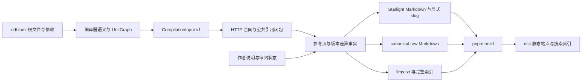

# 版本化 HTTP API 文档：设计、实现与业务验收

关联：[Issue #452](https://github.com/xidl/xidl/issues/452) ·
[PR #462](https://github.com/xidl/xidl/pull/462) ·
[设计](versioned-api-docs.md)。

## 结果与大边界

采用 Starlight 作为站点框架。独立安装的 `xidl-http-docs` 负责生成 Markdown、
版本差异、发布配置与 AI 索引；Starlight 负责 HTML、导航、Pagefind 搜索、主题、
语法高亮和复制按钮。前端 scaffold 单独放在 `crates/xidl-http-docs/frontend/`，
使用官方 Tailwind v4 集成。生成后执行 pnpm install/build，部署 dist 目录。
frontend 保存框架配置、主题、IDL grammar 和轻量宿主主题桥；Cargo 安装保持 纯
Rust，前端工具链只在生成的站点目录运行。

编译器继续拥有 parsing、语义校验、导入解析、版本选择、HTTP 映射和 version-map。
插件复用已有 OpenAPI adapter 读取有效 wire 合同，不再解释 HTTP 注解。 manifest
选择所有显式根与依赖；编译器一次发送整份编译输入，生成一个站点。
`xidl-http-docs.toml` 仅拥有发布配置，不向语言 manifest 增加页面字段。 配置由
`XIDL_HTTP_DOCS_CONFIG` 显式指定，或从当前目录读取；manifest 不会隐式选择它。

最新 review 的命名意见落实为 `CompilationInput`、`CompilationUnit`、
`UnitImport` 和 `VersionInput`，作用域为 `compilation`。新增协议明确表示
本次编译的输入集合；没有额外引入 project 领域对象。现有后端自己的 projection
类型继续拥有原来的语义。新增公开 enum variant 为 `CodegenInput::Compilation`，
依赖穷尽匹配的 Rust 调用方需要同步更新，编译器与插件版本须匹配。



## 从大到小的职责拆分

| 边界         | 拥有的事实与职责                                                         | 入口                                                                                                                                                                           |
| ------------ | ------------------------------------------------------------------------ | ------------------------------------------------------------------------------------------------------------------------------------------------------------------------------ |
| 编译输入     | 复用 LibraryLoader、UnitGraph 与 HIR；记录根单元、导入和版本输入         | [driver/compilation.rs](../../xidlc/src/driver/compilation.rs)、[jsonrpc/compilation.rs](../../xidlc/src/jsonrpc/compilation.rs)                                               |
| HTTP 合同    | 读取有效 routes、schema 和实际使用的 security；保留原始文档元数据        | [contract.rs](../../crates/xidl-http-docs/src/contract.rs)、[documentation](../../crates/xidl-http-docs/src/documentation/)                                                    |
| 变化事实     | wire 规范化、Added/Removed/Changed、短摘要和逐行位置                     | [wire.rs](../../crates/xidl-http-docs/src/wire.rs)、[changes/mod.rs](../../crates/xidl-http-docs/src/changes/mod.rs)、[summary.rs](../../crates/xidl-http-docs/src/summary.rs) |
| 发布集合     | 根 API 的比较范围、共享类型闭包、exclusion、notes 和链接完整性           | [site](../../crates/xidl-http-docs/src/site/)                                                                                                                                  |
| 内容转换     | minijinja 生成 Markdown；AST 重写站内链接与安全 heading；保留 code bytes | [render.rs](../../crates/xidl-http-docs/src/render.rs)、[markdown/mod.rs](../../crates/xidl-http-docs/src/markdown/mod.rs)                                                     |
| 站点框架     | 标准内容集合、导航、搜索、复制、高亮和响应式；小范围 Tailwind 主题       | [frontend](../../crates/xidl-http-docs/frontend/)                                                                                                                              |
| 文件生命周期 | 落盘前检查输出计划；记录 owned 路径；清理旧文件并保护用户文件            | [compilation_output/mod.rs](../../xidlc/src/driver/compilation_output/mod.rs)                                                                                                  |

没有增加事件总线、运行时插件容器或另一套 manifest 调度器。文档发布是同步批处理，
已有 stdio 请求与文件产物就是可组合边界。新增 transport adapter 应消费编译器
已有语义输入；新增站点呈现应消费发布页，不能倒过来控制编译过程。

## Primitive 的四项标准

| Primitive        | Composable                              | General-purpose                       | Orthogonal                         | Stable                                     |
| ---------------- | --------------------------------------- | ------------------------------------- | ---------------------------------- | ------------------------------------------ |
| CompilationInput | 根、依赖、版本输入一次组合              | 任意需要全编译输入的 generator 可选用 | 编译器供给事实，插件决定输出       | 独立 format；既有单元级 generator 流程不变 |
| Contract         | 操作、schema、security、文档组合        | 不绑定 Billing 示例                   | HTTP 规则复用现有 owner            | 分开版本成员名与 wire version              |
| Page             | raw Markdown、站点内容、导航与 AI 共用  | 操作、类型、变化、索引共用身份规则    | 不解析 IDL、不写文件               | 路径由逻辑单元、版本和声明生成             |
| ChangeFact       | 前后合同、引用页、受影响操作组合        | Added/Removed/Changed 不依赖业务      | 机器事实、兼容性与作者解释分开     | 不猜 rename、迁移映射或安全性              |
| IdlSource        | 与事实、字段和操作身份组合              | 任意声明的编译器 IDL 摘录             | 只选择真实 HIR，不生成 wire 规则   | 只去已知版本包装，保留词法 owner           |
| PublishedOpenApi | 操作、引用闭包、security 与 Scalar 组合 | 任意发布 API 的独立下载               | 复用发布集合，不重新定义 exclusion | 固定版本 wire 值与自包含引用               |
| ReleaseNote      | 按根单元与相邻版本对附加解释            | 标准 Markdown 与 TOML 元数据          | 作者拥有 Why/Impact/Upgrade        | strict 检查显式审阅状态与必填说明          |
| 输出清单         | 与生成器文件产物组合                    | 按 generator 记录路径                 | driver 管文件，Starlight 管 dist   | 重建清理 stale owned 文件；冲突明确失败    |

这些类型的价值在于让依赖方向稳定。它们不是为了统一而统一的万能接口：HTTP adapter
明确只支持 HTTP/webhook；非 HTTP 输入返回不支持的错误，避免生成外观 像
HTTP、内容却失真的文档。

## 版本差异与文档体验

首页以相邻版本比较为入口。变更表并排给出 Before/After 的合同摘要；作者的
Impact/Upgrade 紧随其后；真实 IDL 声明放入默认折叠的原生 details。
桌面对照两列，窄屏上下排列。逐行增删位置由 Rust 的 similar 计算，Expressive Code
负责标记和高亮，复制得到编译器打印的 IDL。Author reviewed 与 Compatibility 的
Needs review 分开展示。新增可达类型只表示它新进入发布面，不推断源声明何时编写。
框架原生换行让长声明在窄列内完整可读，复制内容保留原始行；Scalar 的次级文字
和数字高亮复用 Starlight 主题 token。

参考页提供同一逻辑实体的其他版本、相关变化、raw Markdown 和 AI 索引入口。 显式
slug 保留大小写和前导下划线；浏览器导航保留当前 origin 与部署子路径， raw/AI
文件中的 canonical URL 保留配置的完整 origin。浏览器路由与 raw .md
地址各自投影，保留 query、fragment、部署子路径和外链。Astro 与 Rust 对标题 ID
使用同一 GitHub slug 规则，并关闭智能标点转换。作者 HTML 按文本显示，heading
事件属性和 class 不进入站点；fenced code 保留原样。使用普通
Markdown，不加载可执行 MDX。

前端选型来源：[Starlight 内容与 details](https://starlight.astro.build/guides/authoring-content/)、
[官方 Tailwind 集成](https://starlight.astro.build/guides/css-and-tailwind/)、
[Expressive Code 行标记](https://expressive-code.com/key-features/text-markers/)、
[原生换行](https://expressive-code.com/key-features/word-wrap/)、
[Astro heading 实现](https://github.com/withastro/astro/blob/main/packages/markdown/remark/src/rehype-collect-headings.ts)。
主题沿用 [XIDL 官网](https://xidl.netlify.app/) 的蓝色与系统字体。

按用户指定的远端 Python runner，调用 agy 的 gemini-3.8-flash-high 提供只读
版本比较模板与视觉层级建议。主代理选择了渐进展开、紧凑摘要、原生 details 和
局部滚动表格，编写全部文件并负责最终浏览器验收。远端 runner 从指定配置读取
两个路由变量，结束恢复全局设置；本轮未在仓库写入密钥。

IDL 直接复用投影后的 HIR 与现有 IdlPrinter，保留业务模块和接口上下文，只移除
已知版本包装。选择器优先完整定义，区分 inline typedef 的构造类型与 alias，
并只保留目标 declarator。相同源码明确显示 No IDL changes；缺失一侧显示该版本
没有发布声明。类型首次可达与源声明首次出现是不同事实。

每个已发布 API 单元和版本还有独立的 Scalar playground 与 OpenAPI 下载。
它们复用相同的发布操作与引用闭包，跨单元模型改写为同文件引用；排除接口的 tag
一起移除。遍历位置区分 schema、用户命名映射与 literal JSON，名为 description、
examples、default 的业务字段不会被误当元数据，示例中的 $ref 也不会变成依赖。
playground 预填 wire version，Payments 不继承 Billing 的版本头。官方 Starlight
插件负责 Scalar 生命周期，官方 route middleware 保留全站导航，本地锁定资源、
许可证和已有 XIDL Shiki grammar 随 scaffold 输出。Scalar client 的覆盖层需要
在打开时越过 Starlight 内容容器的 isolation；普通浏览仍保留隔离，并通过 Scalar
官方 custom-header-height 变量预留页头，避免滚动后遮挡全站搜索。
这些边界均由真实点击回归与截图检查复验。 Starlight
统一拥有主题选择、持久化和系统偏好。Head 包装保留框架原生内容， 一个复用的
MutationObserver 只将已解析主题投影为 Scalar 的公开 body 模式类， Astro
切页后重新连接；Scalar 自身的主题开关隐藏。系统主题变化时，已打开 client
的输入和响应保留，旧 Scalar 偏好不会覆盖宿主选择。

来源：[Scalar Starlight](https://scalar.com/products/api-references/integrations/starlight)、
[Starlight route middleware](https://starlight.astro.build/guides/route-data/)、
[Scalar host header 合同](https://scalar.com/blog/posts/2026-09-29-release-notes-2026-09-26)。
颜色配置依据为
[Scalar theme variables](https://scalar.com/products/api-references/themes)。
主题桥使用
[Starlight Head 包装](https://starlight.astro.build/guides/overriding-components/#reuse-a-built-in-component)
和
[Astro after-swap](https://docs.astro.build/en/guides/view-transitions/#astroafter-swap)。

## 真实业务测试设计

测试围绕四条长旅程组织，避免给每个错误再复制一套 happy path：

| 旅程             | 关键业务不变量                                                                                                                                                                                                                                  |
| ---------------- | ----------------------------------------------------------------------------------------------------------------------------------------------------------------------------------------------------------------------------------------------- |
| 多根发布与阅读   | manifest 文件、目录、逆序显式根字节一致；Billing v2 共享模型只发布一次，四个正确版本的操作链接共同引用；真实构建后比较页、字段锚点、实体版本、搜索结果、IDL 复制、深色、移动端和无 JS 阅读可用                                                  |
| 缩小、重复与恢复 | 全版本 → Billing v2 → 再次同样发布 → 恢复全 manifest；旧 source、raw、HTML 与 Pagefind 记录实际消失，用户文件保留，重复字节一致；恢复后重新构建并从搜索打开 v1 字段                                                                             |
| 失败与安全恢复   | 缺 notes、未审阅、缺 Impact/Upgrade、未知/重复版本对、引用 excluded 类型、未知设置、非法 base、零/过小索引、危险链接和三段带 metadata 的非法 HTTP/JSON 均失败；比较实际文件树，失败不能留下新文件；修正后正常发布，作者 HTML 不执行、代码可复制 |
| 版本探索与 HTTP  | v1 与 v2 的实际 header 和响应结构；404 记录；无版本 Payments 与共享模型；原生全站导航；Light/Dark/Auto 与旧 Scalar 偏好组合，系统主题变化保留 client 响应；打开页面不请求 API，资源不访问外部服务                                               |

BDD 使用真实 xidlc 和插件进程、独立临时目录、不同工作目录、真实 pnpm 生产构建 和
Chromium。浏览器只允许本地静态站与测试 API，不访问线上业务 API。 文件
source/产物快照属于 `xidl-http-docs` owner；路径、符号链接、未拥有文件冲突
测试属于 driver owner；`///` 元数据读取与 OpenAPI 导入版本测试属于 xidlc owner。
新增测试文件与 runtime 分离，没有 inline test bodies。

可执行入口为
[http_documentation.feature](../../bdd/features/http_documentation.feature)。
文档 owner 的 [测试与快照](../../crates/xidl-http-docs/src/site/tests/)、
[Markdown 回归](../../crates/xidl-http-docs/src/markdown/tests.rs) 与 driver 的
[输出生命周期回归](../../xidlc/src/driver/compilation_output/tests.rs)
分别验证各自的合同。

额外用真实 CLI 和 CI 固定的 pnpm 11.11.0 构建 Catalog fixture：v1/v2 的
`_Product` 路径保持前导下划线与大小写，中文和 emoji 文档保留，HTML 中的 field-id
/ field-name 锚点与生成链接一致。该检查补充 owner 快照对框架路由的覆盖。
逐页核对 Billing 21 页、Catalog 13 页两个实际 dist 中的 1,812
处站内资源与锚点链接：目标文件均存在，指向 HTML 的 fragment 均能对应页面 ID。
首次安装工具依赖和浏览器需要网络；业务请求本身只访问本地，依赖缓存可复用。

两个只读 sub-agents 从发布契约与业务编排分别审阅。IDL/Scalar 完成后再次审阅，
主代理核对并修复 forward 选择、inline typedef、保留字段名引用闭包、排除 tag、
playground 导航等组合问题；对应 owner 回归及真实 HTTP
浏览器旅程通过。主代理通过实际 CLI 复现并
修正发现的问题，收紧了清单外新文件、stale 物理文件、精确引用集合、独立复制
期望值和恢复后搜索的断言。最终决定与所有文件修改由主代理完成。

新增第四条旅程从参考页进入 v1 playground，真实发送请求，再切到 v2，验证实际 HTTP
header 与响应结构；继续请求缺失记录并打开无版本 Payments API，核对错误
响应和共享模型。服务只运行在本地，断言打开页面不会自动请求 API，未尝试外部
CDN、字体、代理或服务。发布缩小、重复与恢复也覆盖新增的 spec 和 playground。

## 上游问题与修复

| Issue                                           | 实际问题                                                  | 修复 owner                                          |
| ----------------------------------------------- | --------------------------------------------------------- | --------------------------------------------------- |
| [#464](https://github.com/xidl/xidl/issues/464) | 未版本化导入模块被名称启发式当作版本                      | OpenAPI DocumentUnits 使用导入 timeline 元数据      |
| [#465](https://github.com/xidl/xidl/issues/465) | 显式 doc 字符串曾保留引号或宽字符串标记                   | 按最新评审撤下显式注解，只消费既有 `///` 元数据     |
| [#466](https://github.com/xidl/xidl/issues/466) | Unicode 转义丢失                                          | 只解码编译器的一层引用，保留 Markdown 原始反斜杠    |
| [#467](https://github.com/xidl/xidl/issues/467) | 生成路径可经 symlink 写到输出目录外                       | driver 路径与所有现有组件预检                       |
| [#468](https://github.com/xidl/xidl/issues/468) | Impact/Upgrade 示例跳过校验，带 fence metadata 同样可绕过 | 三段统一示例验证，先分离语言 token                  |
| [#469](https://github.com/xidl/xidl/issues/469) | 新产物路径覆盖未拥有的用户文件                            | driver 在任何写入前拒绝 unowned 冲突                |
| [#470](https://github.com/xidl/xidl/issues/470) | 有效自动标题链接被判 missing anchor                       | AST heading 索引、显式 ID 和 GitHub slugger         |
| [#471](https://github.com/xidl/xidl/issues/471) | crate 归档包含已安装前端依赖的 773 份 README              | 锚定根 README；使用实际 Cargo 清单的隔离回归        |
| [#472](https://github.com/xidl/xidl/issues/472) | 官网注解页仍跳转到已删除的版本说明页                      | 链接到新的版本说明入口与 Rust adapters 页面         |
| [#473](https://github.com/xidl/xidl/issues/473) | 版本化 readonly 多属性导致 source identity 缺失           | 统一版本路径的名称分隔合同，parser 与真实 HIR 回归  |
| [#474](https://github.com/xidl/xidl/issues/474) | 绝对部署 URL 使本地预览的站内导航跳往线上                 | browser_url 保留部署路径，canonical raw/AI URL 独立 |

## 本地测试环境

本机代理配置把 loopback 请求转发给了代理。这属于测试启动环境问题；
[#475](https://github.com/xidl/xidl/issues/475) 按环境误报关闭，并从本 PR
的修复列表移除。 Upgrade 集成测试恢复为 master
原有实现，保留成功升级、鉴权拒绝与提前拒绝的业务旅程。

在启动测试前，由终端或 CI runner 配置本地地址的代理排除规则：

```sh
export NO_PROXY="${NO_PROXY:+$NO_PROXY,}127.0.0.1,localhost,::1"
export no_proxy="${no_proxy:+$no_proxy,}127.0.0.1,localhost,::1"
python3 -m pip install -r bdd/requirements.txt
python3 -m playwright install --with-deps --only-shell chromium
just test
```

Reqwest 从进程环境读取这些规则，参见
[NoProxy::from_env](https://docs.rs/reqwest/0.13.4/reqwest/struct.NoProxy.html#method.from_env)。
代理配置和工具安装由测试调用方负责。HTTP 旅程继承父进程的代理配置，
浏览器旅程直接使用预先安装的 Playwright；CI 在进入 BDD 前单独安装浏览器。

完整跨语言验收前，还应检查主 `target` 与 `bdd/.temp/rust_target` 的实际路径和
可用容量。部分生成代码检查与服务测试明确使用后者，仅修改外层 `CARGO_TARGET_DIR`
不会转移这批编译。外部 runner 需提前准备容量充足的目录， 并保留 CLI 与 BDD
使用的逻辑路径；磁盘耗尽属于环境失败，不应通过修改业务断言
或在测试中处理环境来掩盖。

## 最新评审：统一使用 `///` Markdown

按维护者的[文档注释建议](https://github.com/xidl/xidl/pull/462#issuecomment-6593535702)
与[移除显式注解建议](https://github.com/xidl/xidl/pull/462#issuecomment-6594190912)，
作者只需在声明及其注解前写 `///`。类型、字段和操作复用同一条编译器元数据链路，
Markdown 正文进入 API 参考、OpenAPI 与 AI 文档，不再维护另一套 `@doc` 输入协议。
公共内建注解注册表和官网说明已同步移除 `@doc`。

这个 Primitive 的职责是承载作者文档：编译器负责收集注释，共享读取器负责读取其
内部元数据，各生成器负责自己的呈现。读取器不再猜测 named、positional 或宽字符串
参数，也不把 `vendor::doc` 当成文档。通用自定义注解仍按编译器既有规则解析；显式
`@doc` 会收到 unknown-annotation lint 提示，不能替代 `///` 生成正文。

IDL 比较继续复用既有打印器并省略内部文档元数据，说明文字修改不会制造接口结构
差异。作者可以使用普通 Markdown；JSDoc 和 `[Foo]` 符号引用解析留给后续独立功能。
现有路由、字段锚点与 OpenAPI 引用规则保持各自的职责。

回归使用真实源码经过 parser 和 HIR，覆盖 Unicode、引号、字面反斜杠、Tab、
段落、列表与代码围栏，并验证同名自定义元数据及数组参数不会被读成正文。 既有四条
BDD 旅程补充独立的预期描述，核对 v1/v2 schema、字段、操作、AI 文档、 浏览器
Markdown 渲染与复制，以及 `///` 中的作者 HTML 保持字面显示。

## 验证记录与边界

### 本轮 `///` 评审修改

| 验证                                                   | 结果                                                                                                         |
| ------------------------------------------------------ | ------------------------------------------------------------------------------------------------------------ |
| 真实 parser/HIR 文档读取回归                           | 2 个测试通过；保留 Markdown、Unicode、引号、字面反斜杠与 Tab，同名注解不会替代正文                           |
| parser lint 回归                                       | 11 个测试通过；`///` 元数据不产生诊断，显式 `@doc` 为 unknown-annotation warning                             |
| 文档 owner                                             | 16 个测试通过；更新并人工核对 2 份快照，导航快照保持一致                                                     |
| 文档独立 BDD                                           | 4 scenarios、18 steps 通过；正文、OpenAPI、AI 文档、复制与作者 HTML 均验证                                   |
| workspace locked all-features check/test 与严格 Clippy | 通过                                                                                                         |
| pre-commit run -a、cargo fmt --all -- --check          | 通过                                                                                                         |
| 完整 just test                                         | 35 features、179 scenarios、851 steps；零失败、零跳过                                                        |
| just test-coverage                                     | 通过：HTTP 100.00%、parser 94.93%、JSON-RPC 91.69%、Axum 87.38%                                              |
| cargo publish --workspace --dry-run --allow-dirty      | 通过；8 个包在全新隔离 target 中验证                                                                         |
| parser strict 95%                                      | 94.93%（8799/9269），与已授权基线完全一致，单列为基线例外；门槛保持 95%                                      |
| 官网与生成站点                                         | 官网、Billing 与 Catalog 生产构建和 Astro check 通过；真实浏览器核对注解页及版本页，并更新 IDL/Markdown 截图 |

完整 `just test` 曾因本机两处构建缓存所在磁盘容量不足而中止或出现编译失败。 外部
runner 先核对物理目录和容量、迁移自有缓存，并保留全部 CLI/BDD 逻辑路径，
随后重新执行完整命令得到上述 179/179 结果。测试源码没有增加磁盘或代理规避逻辑，
也没有通过筛选失败场景来替代完整重跑。

本轮移除 parser 的 Doc 注册并增加 lint 回归后，严格覆盖率仍为
8799/9269。该非零门禁结果按用户已有授权单独记录；当前 HEAD 的远端检查结果见
[PR 当前 HEAD 的交付记录](https://github.com/xidl/xidl/pull/462)。

### 历史功能验收

以下完整功能验收的本地记录对应提交 `56faed92`。线性 rebase 保留原有功能实现，
随后还原 Upgrade 测试并补充调用方的环境配置说明。最新修改的验证结果记录在 PR
交付评论中，远端状态以
[PR #462 当前 HEAD 的检查](https://github.com/xidl/xidl/pull/462/checks)
为准；历史提交的通过结果不替代当前 HEAD 的 CI。

| 验证                                                       | 结果                                                                                                     |
| ---------------------------------------------------------- | -------------------------------------------------------------------------------------------------------- |
| pre-commit run -a、cargo fmt --all -- --check              | 通过                                                                                                     |
| workspace locked all-features check/test                   | 通过；文档 owner 16 个测试、3 份渲染快照，parser 327 个测试                                              |
| 文档插件 standalone locked check                           | 通过；Cargo 安装与构建无需前端工具链                                                                     |
| workspace all-targets/all-features Clippy，warnings 为错误 | 通过                                                                                                     |
| 文档独立真实 BDD                                           | 4 scenarios、18 steps，零失败、零跳过                                                                    |
| 完整 just test                                             | 35 features、179 scenarios、851 steps，零失败、零跳过；含 Rust、Go、TypeScript、npm 与实际 HTTP 业务流程 |
| just test-coverage                                         | 通过；另列 strict parser 95% 已授权基线例外                                                              |
| 全新隔离 target 的完整 workspace publish dry-run           | 通过；未实际发布                                                                                         |
| 实际 Cargo package 清单                                    | 69 个文件；scaffold 完整，node_modules、dist、.astro 和下载 bundle 均不入包                              |
| Billing / Catalog 实际 CLI、pnpm 11.11.0 frozen 生产构建   | 通过；前端各 8 份源码检查为 0 errors / 0 warnings / 0 hints                                              |
| 34 页站内资源与锚点                                        | 1,812 处，零缺失                                                                                         |
| 官网 frozen install/build 与 Astro 检查                    | 通过；0 errors / 0 warnings / 1 个既有 hint                                                              |

此次集成审查还修正 #472 的两处官网链接，并将新增文档 crate 加入 release-please
的 Cargo.lock 更新清单；逐一核对九个 workspace 包都具备更新规则。 官网另通过
pnpm frozen install、production build 和 Chromium 实际点击验收：
生命周期注解页进入版本说明，默认值注解页进入 Rust adapters，均显示对应标题；
原来的缺失路由也已在本地复现。`astro check` 为 0 errors、0 warnings、1 hint，
该提示来自既有 SiteTitle 对 Starlight Props 类型的弃用引用。 官网配置原本包含
Context7 widget；本地点击验收阻断该外部脚本并记录加载尝试， 两条目标路由均返回
200、显示对应标题，页面没有 JavaScript 错误。

历史验收与当时 master 的 parser strict 95% 均为
94.93%（8799/9269），用户已授权记录这项基线例外。此前 #473
修改路径分隔逻辑并新增 owning regression 后，复测仍为 94.93%（8799/9269）。最新
`///` 评审修改的覆盖率另行复测并记录，strict 95% 门槛保持原值。
业务测试使用本地生产构建，未部署到线上；首次工具依赖与浏览器安装需要网络。

发布校验完成后才进入 driver 写入；路径预检能提前发现既有冲突和 symlink。
文件系统写入仍是串行操作，不承诺任意 I/O 故障或并发攻击下的跨文件原子事务。
已生成的 Starlight source 更新后必须再次 pnpm build 才会刷新 dist 和搜索。 相对
base 没有 canonical origin 时，框架会提示跳过 sitemap；配置绝对 URL 可启用。
JSON 示例验证语法，HTTP 示例验证方法与已发布路由；这些检查不执行真实 API 请求，
也不代表 SDK 编译或线上业务验收。

另用 axe-core 4.14.0 检查首页、比较页、展开 IDL、深色、移动端以及 Scalar
参考页和 client 的深浅色，共九种状态。IDL 行滚动与 Scalar 对比度告警已修正；
移动端没有自动违规。桌面仍报告同一个搜索按钮的
`label-content-name-mismatch`。人工核对后将其记为快捷键提示被当成标签的误报：
可见标签和可访问名称都是 Search，⌘K 是操作提示，实际键盘操作与
`aria-keyshortcuts` 一致。浏览器实测给提示增加 aria-hidden 后告警仍存在；
[axe 实现](https://github.com/dequelabs/axe-core/blob/v4.14.0/lib/checks/label/label-content-name-mismatch-evaluate.js)
按屏幕可见文本比较，因此没有为消除告警修改或复制框架组件。这是针对该按钮的
人工判断，不是关闭整条规则，也不代表完整 WCAG 合规认证。判断参考
[W3C Label in Name](https://www.w3.org/WAI/WCAG22/Understanding/label-in-name.html)
和
[WAI-ARIA aria-keyshortcuts](https://www.w3.org/TR/wai-aria-1.2/#aria-keyshortcuts)。

Scalar client 的两个状态还各有 3 个 aria-prohibited-attr 和 9 个
aria-required-attr 节点：锁定的第三方 More Information 控件带 role=none，
CodeInputLite 的 combobox 缺少 aria-expanded / aria-controls。这里记录为
第三方表单的待处理语义告警；没有通过改写其 DOM 来压制扫描结果， 本 PR
不声明这些表单已通过完整无障碍审计。

重复验证同一开发版本时，Cargo 1.94 的临时 registry 可复用该路径下旧的解包
缓存。主代理核对归档、index 校验和和实际缓存源码后，使用全新隔离 target 目录
重新执行完整发布 dry-run；没有修改依赖版本或加入 API 兼容层。依据为
[Cargo 1.94 解包缓存实现](https://github.com/rust-lang/cargo/blob/rust-1.94.0/src/cargo/sources/registry/mod.rs#L578-L597)。
归档清单另有真实缺陷：裸 README.md 会匹配任意层的同名文件。已登记 #471，
锚定为根 README，并在 owner 测试中用实际 Cargo、实际 include 规则和隔离 fixture
验证 scaffold 保留且 node_modules / dist / .astro 均排除；该测试修复前确实失败。
此前归档修复将清单从 829 个文件收敛到 57 个；本轮新增 Scalar/IDL
与主题桥后，实际包清单为 69 个文件。本地生成的 Scalar bundle
与安装依赖均不入包。

## 工具调用简报

| 工具                        | 触发原因与关键输入                            | 结果                                         |
| --------------------------- | --------------------------------------------- | -------------------------------------------- |
| GitHub connector 与 gh      | Issue #452、PR #462、review threads           | 核对需求与评论，登记可复现的上游问题         |
| 两名只读 sub-agents         | 发布合同、完整业务编排、Compilation 命名      | 主代理以源码和实际 CLI 复核，并亲自修改      |
| SSH、Python runner、agy     | 用户指定远端脚本与 Gemini 模型                | 只读前端建议，采用原生展开与并排比较         |
| xidlc、插件、pnpm、Chromium | 三种根入口、生产构建、真实页面与本地 API 操作 | 检查发布、版本恢复、搜索、复制和安全边界     |
| Cargo、Just、pre-commit     | Rust 与跨语言测试、覆盖率、打包与格式门禁     | 以本节的实际门禁记录为准，严格覆盖率例外单列 |

## 截图

六张页面截图以 GitHub 附件展示在
[PR #462 描述](https://github.com/xidl/xidl/pull/462)中，
涵盖版本入口、变化表、IDL 差异、Markdown、移动端和 Scalar playground。
