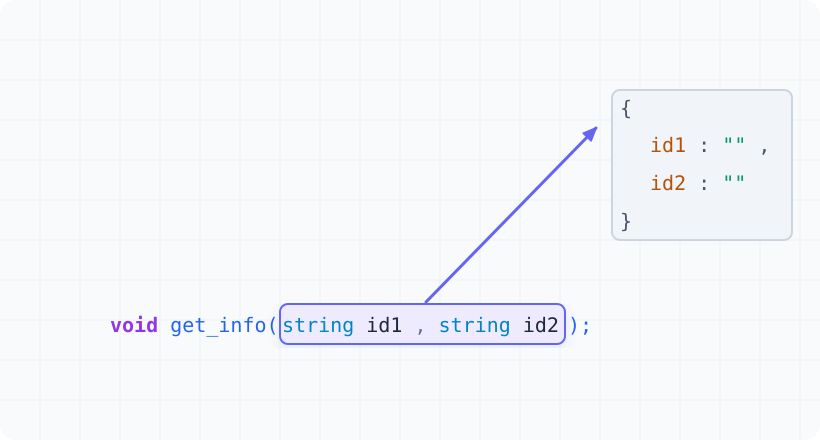
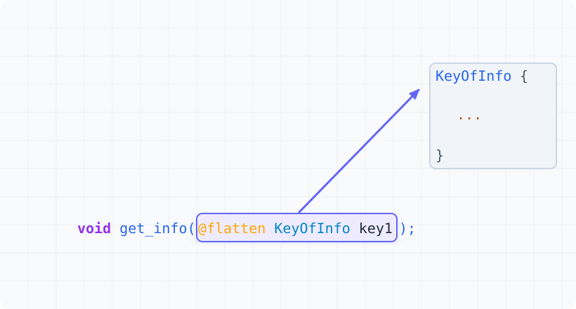
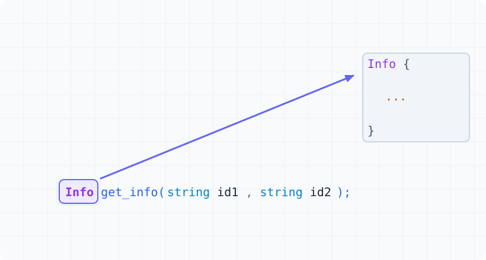
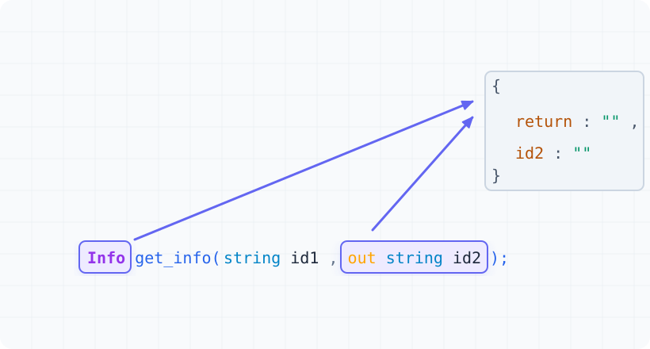

This page describes how method parameters and return values are shaped into
HTTP request and response bodies.

Renaming and skipping annotations (`@rename`, `@rename_all`, `@skip`,
`@optional`) are documented in the [Wire Shape](/docs/annotations/wire/)
reference.

Struct inheritance is flattened into the same JSON object. A base struct's
members participate in request decoding, response encoding, OpenAPI schemas,
and generated validators exactly like the derived struct's own members. See
[Struct Inheritance](/docs/#struct-inheritance) for the inheritance rules.

## JSON Wire Values

Rust Axum, Go REST, TypeScript REST and OpenAPI share these JSON shapes:

| IDL value | JSON representation |
| --- | --- |
| Ordinary union | An object with `tag` and `data` |
| `sequence<octet>` | An array of numbers from 0 through 255 |
| `char` / `wchar` | A string containing one Unicode scalar value |
| Fixed array | An array with exactly the declared dimensions |
| Integer | A JSON number within the declared IDL range |
| Absent `@optional` member | An omitted property |

For example, both labels select the same payload type while retaining the
label received on the wire:

```idl
union Change switch (long) {
    case 0:
    case 1: string title;
    default: string reason;
};
```

```json
{ "tag": "1", "data": "New title" }
```

The default label is represented as `"default"`. Unknown tags and payloads
that do not match the selected branch are rejected. Nested payloads retain
their own `@rename`, `@rename_all`, `@skip` and optional-member rules.
An `@http union` uses the media-type mapping below.

JSON fields use their declared types: numeric strings, fractional integers,
missing required members and malformed array dimensions are rejected. Path,
query, header and cookie bindings arrive as text and are parsed into their
declared types. Declared HTTP exceptions encode their body fields as JSON;
header and cookie members travel in their respective HTTP bindings.

64-bit integers remain JSON numbers. JavaScript can lose integer precision
above `2^53 - 1`; a contract that requires exact large values declares a
`string`, and the application parses it. See the
[serialization decision in #335](https://github.com/xidl/xidl/issues/335).

The cross-target BDD probe runs the same Hurl requests against all three
generated servers, validates recorded responses against generated OpenAPI,
and runs each generated SDK against every server. Structured stream checks
also validate item and declared error bodies, including their terminal frame.

## Parameter Encoding Methods

### Multi-parameter Input Encoding Method



### Single-parameter Input Flattened Encoding Method



### Return Value Encoding Method



### Multi-return Value Encoding Method



## Multiple Response Media Types

Use one operation returning an `@http union` when the same route can return
several representations. `ContentType` is built into the compiler; no enum
declaration or include is needed.

```idl
struct FileMeta { string title; };

@http
union FileResponse switch (ContentType) {
    case ContentType::Json: FileMeta meta;
    case ContentType::OctetStream: sequence<octet> raw;
    case ContentType::Text: string text;
};

@no_security
interface Files {
    @get(path = "/file")
    FileResponse read(@header @rename("ETag") out string etag);
};
```

| Built-in member | Response Content-Type |
| --- | --- |
| `Json` | `application/json` |
| `OctetStream` | `application/octet-stream` |
| `Text` | `text/plain` |

Each union may use a subset of these members. Every branch needs one distinct
member label; `default` branches and custom discriminator types are rejected.
The response body contains the selected payload, without a JSON union tag.
The handler selects the variant, and the server checks that the request's
`Accept` header permits that variant. Response headers and cookies remain
operation output parameters. OpenAPI lists the declared media types under the
same operation's success response.

With an `@http union` present, root-level `ContentType` is reserved. If a local
declaration shadows it, use `switch (::ContentType)` to refer to the built-in
one. Qualified case labels such as `::ContentType::Json` are also supported.

The shared `xidl-http` runtime owns `ContentType`. Its member table defines both
the Rust type and the IDL declaration used by the compiler. Generated Axum code
references `xidl_rust_axum::http::ContentType`; it never declares or imports a
local copy. Generating files in separate `xidlc` processes therefore works just
like generating them in one invocation, including when the resulting Rust files
are included in the same module. TypeScript and OpenAPI consume the media types
resolved from this same declaration.

In IDL, this built-in is only supported in HTTP union switches and their case
labels. Fields, parameters, return values, and aliases cannot reference external
runtime types. This IDL restriction does not prevent handwritten Rust from using
the shared runtime enum directly.
Ordinary unions without `@http` retain their existing discriminator and
`default` rules. HTTP representation generation is supported by Rust Axum,
TypeScript REST, and OpenAPI; it is not currently supported by Go REST.

## Recommended Reading

- [HTTP & REST Basics](/rest/)
- [Annotations](/docs/annotations/)
